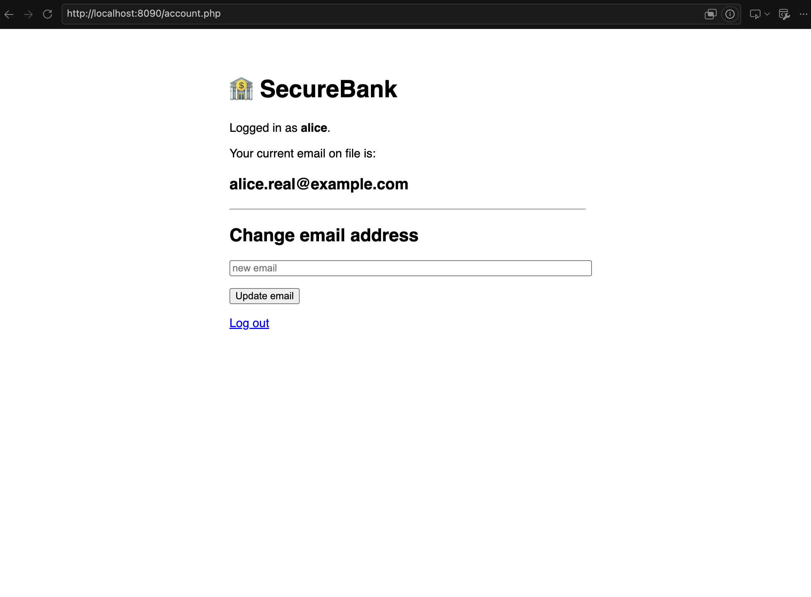
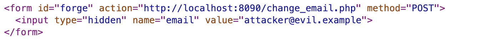
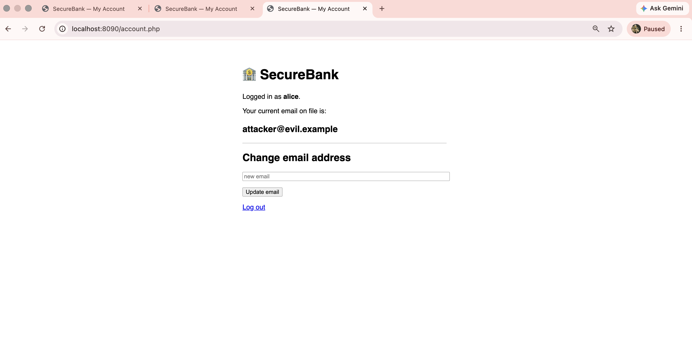
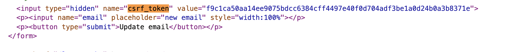
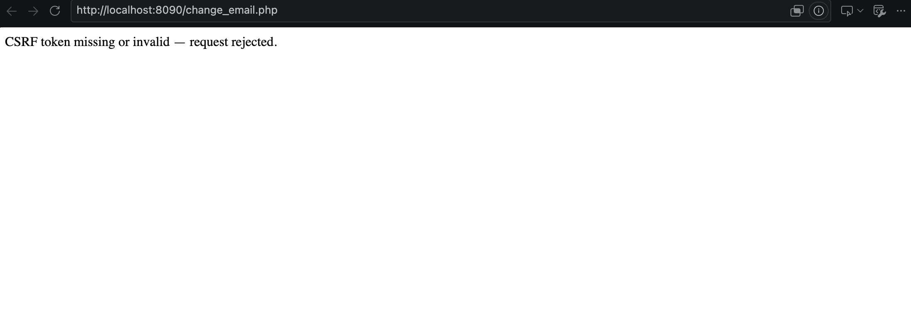
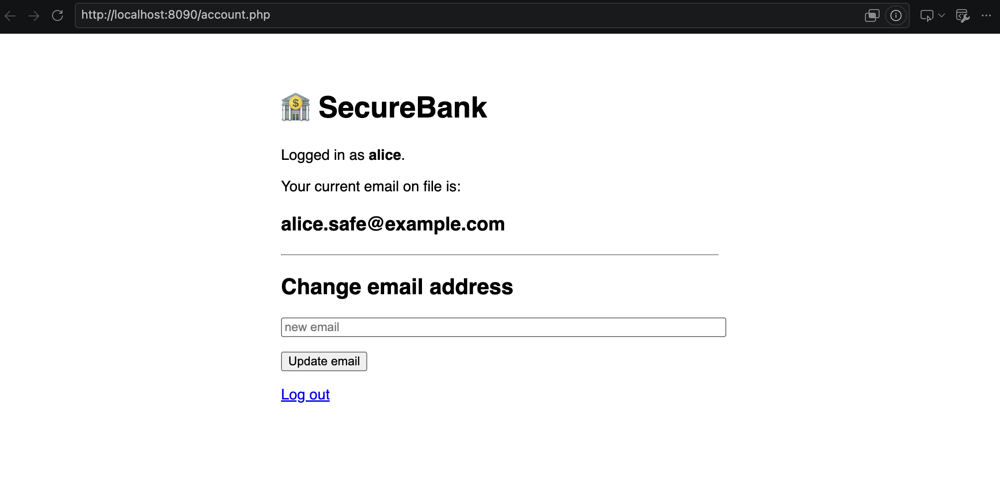
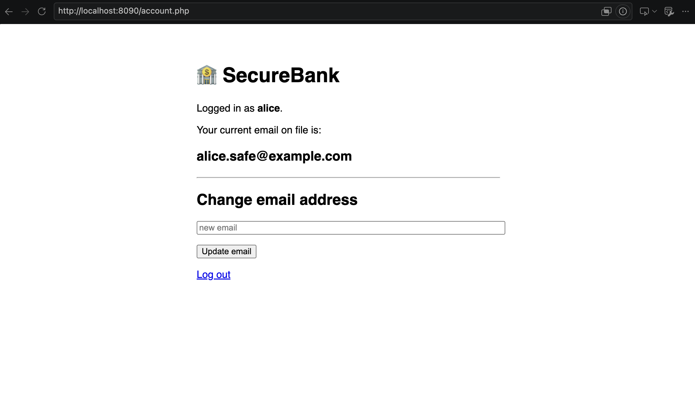

# CSRF: Building a Vulnerable Form and Defending It with Tokens

**Module:** WEB404 — Secure Coding Practices
**Practical Assignment 5**
**Student ID:** 02230302

---

## 1. Introduction

### What is CSRF?

**Cross-Site Request Forgery (CSRF)** is an attack that tricks a logged-in
user's browser into sending a request the user never intended, to a site where
they are already authenticated. The malicious request is "forged" because it is
triggered by a different, attacker-controlled website, but it arrives looking
like a genuine action from the victim.

The attack abuses one specific browser behaviour: **the browser automatically
attaches a site's cookies to every request aimed at that site — no matter which
website caused the request.** So if you are logged into your bank in one tab and
visit a malicious page in another, that malicious page can cause requests to
your bank, and your bank's session cookie rides along automatically.

Crucially, the attacker **never sees** the response and **never steals** the
cookie. They do not need to. They only need the *side effect* of the request —
money moved, email changed, password reset.

### Impact

If a state-changing action is not protected, an attacker can make an
authenticated victim unknowingly:

- change their account email or password (account takeover),
- transfer money or make a purchase,
- change security settings,
- perform any action the victim is allowed to perform.

Changing the email is especially dangerous: once the attacker controls the
email on file, they can trigger a "forgot password" reset and take over the
account completely.

### OWASP reference

CSRF is a long-standing entry in OWASP's materials. In the **OWASP Top Ten**
it is today folded into **A01:2021 – Broken Access Control** (CSRF was its own
category, A8, in the 2013 list). OWASP's dedicated guidance is the
**[OWASP Cross-Site Request Forgery Prevention Cheat Sheet](https://cheatsheetseries.owasp.org/cheatsheets/Cross-Site_Request_Forgery_Prevention_Cheat_Sheet.html)**,
which recommends the synchronizer token pattern used in this lab, backed up by
`SameSite` cookies and Origin/Referer checks as defence in depth.

---

## 2. Lab setup and ethical considerations

### Architecture

The lab runs **two separate web servers** using Docker Compose. Two servers are
essential: CSRF is a *cross-site* attack, so we need a genuinely different
website (a different origin) to launch the forgery from.

| Role | URL | Port (bound to 127.0.0.1) |
|------|-----|---------------------------|
| **Victim** — "SecureBank" account app | `http://localhost:8090` | `127.0.0.1:8090` |
| **Attacker** — malicious site | `http://127.0.0.1:9090` | `127.0.0.1:9090` |

Both are plain `php:8.2-apache` containers (see `docker-compose.yml`).

### Why two different origins — and why `localhost` vs `127.0.0.1`?

An **origin** is the combination of *scheme + host + port*. The victim
(`localhost:8090`) and the attacker (`127.0.0.1:9090`) differ in host, so they
are a **different origin** *and* a **different site**:

- **Different origin** → the browser's **same-origin policy** stops the attacker
  page from *reading* the victim's pages. This is exactly why the attacker
  cannot steal the CSRF token later.
- **Different site** → the attack is a true cross-site request, so the
  `SameSite` cookie attribute is relevant (discussed in §6).

Using `localhost` for one and `127.0.0.1` for the other gives us two different
hostnames that both resolve locally, so we get a realistic cross-site setup
**without editing `/etc/hosts`** (no admin rights needed).

### Ethical considerations

- **Everything is local.** Both ports are bound to `127.0.0.1` only, so neither
  server is reachable from the network or the internet.
- The "attack" only ever targets our own deliberately-vulnerable app.
- The app uses a hardcoded demo login and fake data — no real credentials or
  personal data are involved.
- The purpose is strictly educational: to understand the vulnerability well
  enough to prevent it.

### Running the lab

```bash
docker compose up -d          # start both servers
# victim:   http://localhost:8090   (login: alice / password123)
# attacker: http://127.0.0.1:9090
docker compose down           # stop everything
```

---

## 3. The vulnerable form

The victim app is a tiny "SecureBank" account page. After logging in, the user
can change the email address on file. The state-changing endpoint is
`victim/change_email.php`.

**The vulnerable version simply trusts any POST that carries a valid session
cookie:**

```php
// change_email.php — VULNERABLE version
if ($_SERVER['REQUEST_METHOD'] === 'POST') {
    // We accept ANY POST with a valid session cookie.
    // We never check where the request came from, and we never
    // require a secret that only our own page would know.
    $_SESSION['email'] = $_POST['email'] ?? $_SESSION['email'];
    header('Location: /account.php');
    exit;
}
```

There is nothing here that distinguishes a real click on our form from a request
forged by another website. The session cookie answers *"who is this?"* but not
*"did this request really come from our own page?"*.

### Showing it works normally

Logged in as `alice`, submitting the form changes the email as expected.


*[SCREENSHOT: 01_normal_change.png — account page after a legitimate email change]*

---

## 4. The attack

### The attacker page

`attacker/index.html` is served from the *other* origin. It contains a hidden
form that auto-submits to the victim as soon as the page loads:

```html
<!-- attacker/index.html -->
<form id="forge" action="http://localhost:8090/change_email.php" method="POST">
  <input type="hidden" name="email" value="attacker@evil.example">
</form>
<script>
  document.getElementById('forge').submit();   // fires on page load
</script>
```

The victim sees only a cheerful "Congratulations!" message for a split second
before the request fires — in a real attack it would be completely invisible.


*[SCREENSHOT: 03_attacker_page.png — view-source of the attacker page showing the hidden form]*

### Carrying out the attack

1. Log into SecureBank (`http://localhost:8090`) as `alice`.
2. In the **same browser**, visit the attacker page (`http://127.0.0.1:9090`).
3. The hidden form auto-submits, the browser attaches SecureBank's session
   cookie, and the email is changed — without the user's knowledge or consent.


*[SCREENSHOT: 02_attack_success.png — SecureBank account page now showing attacker@evil.example]*

The browser lands back on SecureBank's own account page (because the endpoint
redirects there), now displaying `attacker@evil.example`.

### Confirming it with curl (terminal evidence)

`curl` makes the mechanism explicit — the forged request carries only the
session cookie and announces (via the `Origin` header) that it came from the
attacker site, yet the server accepts it:

```
=== email before attack ===
Your current email on file is: alice@example.com

=== the forged cross-site request ===
$ curl -b victim_session.txt \
       -H "Origin: http://127.0.0.1:9090" \
       -d "email=attacker@evil.example" \
       http://localhost:8090/change_email.php
forged request HTTP 302          <-- accepted!

=== email after attack ===
Your current email on file is: attacker@evil.example
```

### Why it works

- The victim has a live session → the browser holds SecureBank's session cookie.
- The attacker's page, on a different site, tells the browser to POST to
  SecureBank.
- **The browser automatically attaches SecureBank's cookie** to that request,
  because cookies are attached per-destination, regardless of who started the
  request.
- The server sees a valid session and a well-formed POST and **cannot tell** it
  apart from a genuine request, because the genuine request carries nothing
  secret that the attacker could not also supply.

---

## 5. The fix: CSRF tokens (synchronizer token pattern)

The defence is to require a secret that **only a genuine SecureBank page could
know**: a random, per-session **CSRF token**.

- It is stored in the server-side session.
- It is embedded as a hidden field in our real form.
- It is verified on every state-changing POST.

Because the attacker's page is on a different origin, the **same-origin policy
stops it from reading** our page — so it can never learn the token, and can
never submit a matching one.

### The token helper

```php
// csrf.php
function csrf_token(): string {
    if (empty($_SESSION['csrf_token'])) {
        // 32 random bytes -> 64 hex chars, cryptographically unguessable.
        $_SESSION['csrf_token'] = bin2hex(random_bytes(32));
    }
    return $_SESSION['csrf_token'];
}

function csrf_check(?string $submitted): bool {
    // hash_equals = constant-time compare (defeats timing attacks).
    return !empty($_SESSION['csrf_token'])
        && is_string($submitted)
        && hash_equals($_SESSION['csrf_token'], $submitted);
}
```

### Embedding the token in the real form

```php
// account.php
<form method="POST" action="/change_email.php">
  <input type="hidden" name="csrf_token" value="<?= htmlspecialchars(csrf_token()) ?>">
  <input name="email" placeholder="new email">
  <button type="submit">Update email</button>
</form>
```


*[SCREENSHOT: 07_token_in_source.png — view-source of account.php showing the random hidden csrf_token]*

### Verifying the token on submit

```php
// change_email.php — SECURE version
if ($_SERVER['REQUEST_METHOD'] === 'POST') {
    if (!csrf_check($_POST['csrf_token'] ?? null)) {
        http_response_code(403);
        exit('CSRF token missing or invalid — request rejected.');
    }
    $_SESSION['email'] = $_POST['email'] ?? $_SESSION['email'];
    header('Location: /account.php');
    exit;
}
```

### The same attack now fails

The attacker page is **unchanged**. Re-running the attack now hits the token
check and is rejected with HTTP 403:


*[SCREENSHOT: 05_attack_blocked.png — "CSRF token missing or invalid — request rejected."]*

The email on file is left untouched:


*[SCREENSHOT: 06_email_unchanged.png — account page, email unchanged after the blocked attack]*

Meanwhile the legitimate form still works, because it carries the token:


*[SCREENSHOT: 04_legit_still_works.png — normal email change still succeeds after the fix]*

### curl evidence of the fix

```
=== (a) forged request, no token ===
$ curl -b session.txt -H "Origin: http://127.0.0.1:9090" \
       -d "email=attacker@evil.example" http://localhost:8090/change_email.php
CSRF token missing or invalid — request rejected.
forged -> HTTP 403               <-- rejected
email after forged attempt: alice@example.com   (unchanged)

=== (b) legitimate request, token read from our own form ===
$ TOKEN=$(curl -b session.txt http://localhost:8090/account.php | grep csrf_token | ...)
$ curl -b session.txt -d "csrf_token=$TOKEN&email=alice.legit@example.com" \
       http://localhost:8090/change_email.php
legit -> HTTP 302                <-- works
email after legit change: alice.legit@example.com
```

---

## 6. Vulnerable vs secure, and defence in depth

### Code comparison

| | Vulnerable | Secure |
|---|-----------|--------|
| **Real form** | email field only | email field **+ hidden `csrf_token`** |
| **Server check** | session cookie only | session cookie **+ `csrf_check()`** |
| **Forged POST** | accepted (302) | rejected (403) |
| **Legit POST** | accepted | accepted |

```diff
  // change_email.php
  if ($_SERVER['REQUEST_METHOD'] === 'POST') {
+     if (!csrf_check($_POST['csrf_token'] ?? null)) {
+         http_response_code(403);
+         exit('CSRF token missing or invalid — request rejected.');
+     }
      $_SESSION['email'] = $_POST['email'] ?? $_SESSION['email'];
      header('Location: /account.php');
      exit;
  }
```

### Layers of defence

The CSRF token is the primary fix, but real apps combine several layers:

1. **Synchronizer CSRF tokens** *(what we implemented)* — a secret the attacker
   cannot read, required on every state-changing request. The strongest and most
   complete defence on its own.

2. **`SameSite` cookies** — a cookie attribute that tells the browser *not* to
   send the cookie on cross-site requests.
   - `SameSite=Lax` (the modern browser default) already blocks cross-site
     **POST** requests like our attack.
   - `SameSite=Strict` is even stricter.
   - In this lab we deliberately set **`SameSite=None`** on the session cookie
     so the classic attack could be demonstrated at all. This mirrors older apps
     written before `SameSite` defaults existed, and shows why the default
     changed. In production you would set `SameSite=Lax` (or `Strict`) **as well
     as** using tokens — defence in depth, not either/or.

3. **Checking the `Origin` / `Referer` header** — on a state-changing request,
   confirm the header matches our own site and reject it otherwise. Cheap to add,
   but these headers are occasionally absent, so it is a supporting check rather
   than the sole defence.

No single layer is relied upon: tokens are the core, `SameSite` and Origin checks
reduce the attack surface further.

### Why CSRF and XSS are different problems

These are often confused but are distinct:

- **CSRF** abuses the *trust a site has in the user's browser* (the auto-sent
  cookie). The attacker acts **blind** — they cause a request but never read the
  response.
- **XSS (Cross-Site Scripting)** is the attacker running **their own JavaScript
  inside the victim site's origin**.

This difference matters: **XSS defeats CSRF tokens.** If an attacker can run
JavaScript on SecureBank's own pages (XSS), that script *can* read the CSRF
token from the DOM (it is same-origin now) and submit a perfectly valid request.
So CSRF tokens assume the site is free of XSS. That is why both must be fixed:
CSRF tokens stop cross-site forgery, and output escaping / Content-Security-Policy
stop XSS — neither replaces the other.

---

## 7. Conclusion

This lab built a realistic two-origin setup, created a state-changing form with
no CSRF protection, and showed a separate attacker site silently changing a
logged-in user's email — proving the danger. We then applied the synchronizer
token pattern: a random per-session secret embedded in the real form and
verified on submit. The *same* attack then failed with HTTP 403, while
legitimate use kept working.

The key lesson: **a session cookie proves who the user is, but not that the
request came from your own page.** Any state-changing request needs a second
proof — an unguessable token the attacker cannot read — reinforced by `SameSite`
cookies and Origin checks, and kept effective by also preventing XSS.

---

## Appendix: file layout

```
.
├── docker-compose.yml        # two servers, both bound to 127.0.0.1
├── victim/                   # SecureBank (http://localhost:8090)
│   ├── config.php            # session + deliberately weakened cookie
│   ├── index.php             # login (alice / password123)
│   ├── account.php           # shows email + change-email form (+ token after fix)
│   ├── change_email.php      # state-changing action (+ token check after fix)
│   ├── csrf.php              # token generate/verify helper (the fix)
│   └── logout.php
├── attacker/                 # malicious site (http://127.0.0.1:9090)
│   └── index.html            # hidden auto-submitting forged form
└── screenshots/              # evidence (01–07)
```

The git history follows the same story: vulnerable app → attacker page → fix.
Use `git log` and `git show <commit>` to see the vulnerable version preserved.
```
